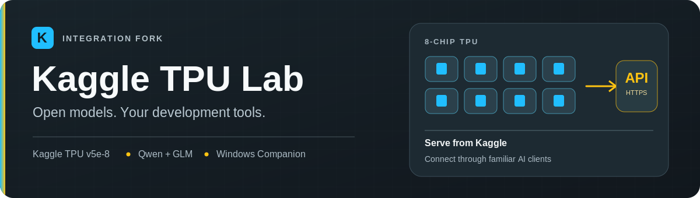
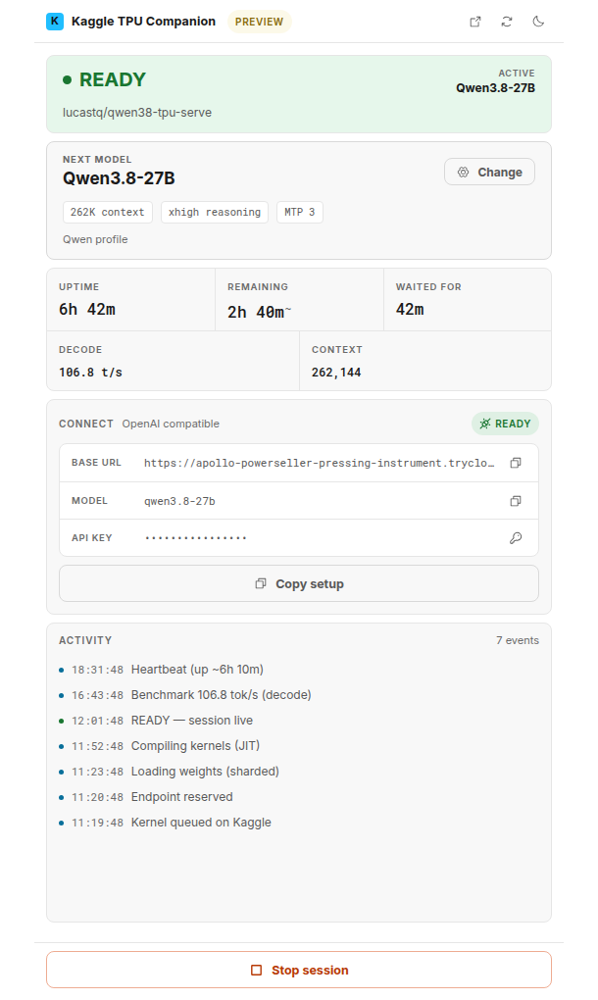
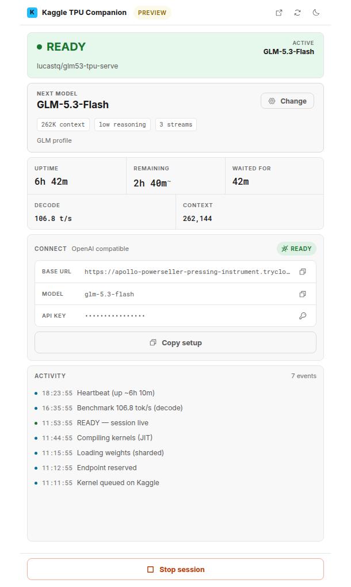
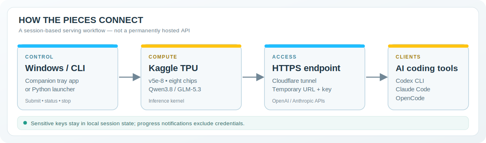

<p align="center">
  
</p>

<p align="center">
  <strong>Serve Qwen and GLM models on Kaggle TPU, then connect your development tools through familiar APIs.</strong>
</p>

<p align="center">
  <a href="#quick-start">Quick start</a> ·
  <a href="#windows-companion">Windows Companion</a> ·
  <a href="#how-it-works">Architecture</a> ·
  <a href="#testing-and-release-status">Testing</a> ·
  <a href="docs/INTEGRATION.md">Integration notes</a>
</p>

# Kaggle TPU Lab

This repository brings together **[ARahim3's Kaggle TPU inference recipes](https://github.com/ARahim3/kaggle-tpu-lab)** and the **[Windows desktop Companion by Haz4rdovisk](https://github.com/Haz4rdovisk/kaggle-tpu-lab)**. Run an open model in a Kaggle TPU session and expose an API compatible with OpenAI- or Anthropic-style clients, including Codex CLI, Claude Code and OpenCode.

> [!IMPORTANT]
> **Source integration is merged, but live QA is incomplete.** [PR #2](https://github.com/xuan2261/kaggle-tpu-lab/pull/2) brought the inference and Companion sources into `main`. Automated tests and browser previews do **not** prove that a Kaggle TPU session or installed Windows app passed end-to-end acceptance. The optional Benchmarks Model Proxy adapter is under separate review.

## What is included?

| Component | What you get | Where to look |
|:--|:--|:--|
| **Qwen3.8-27B** | BF16 inference via vLLM-TPU, with a bundled MTP rollback patch | [Recipe and limits](qwen38-27b/README.md) · [Notebook](qwen38-27b/notebook/qwen38-tpu-serve.ipynb) |
| **GLM-5.3-Flash** | JAX/Pallas serving engine, quantized experts, speculative decoding; upstream supports up to three concurrent streams at 262k context | [Recipe and limits](glm53-flash/README.md) · [Notebook](glm53-flash/notebook/glm53-tpu-serve.ipynb) |
| **Windows Companion** | Tauri 2 desktop/tray interface for model selection, launch settings, session state and connection information | [Rust backend](src-tauri/src/) · [React UI](src/) |
| **Kaggle Benchmarks Model Proxy (optional)** | Separate localhost adapter for Kaggle's existing OpenAI/Anthropic interfaces; consumes AI Models USD quota, not TPU hours | [Local adapter guide](docs/KAGGLE_MODEL_PROXY.md) |
| **Optional cloud route** | GLM on a rented Google Cloud TPU VM instead of a Kaggle notebook | [GCP guide](gcp/README.md) **(billable)** |

**Performance and capacity:** Both upstream recipes document configurations reaching a 262,144-token context and provide their own benchmarks. Those numbers are **upstream measurements**, not independently reproduced performance results for this integration fork. Kaggle TPU access, quota, startup duration and model behavior can vary.

## Kaggle Benchmarks Model Proxy (optional)

Kaggle also offers hosted **Benchmarks Model Proxy** inference that uses your account's separate **Daily/Monthly AI Models USD quota**. This does **not** start Qwen/GLM on your TPU. Kaggle already provides both OpenAI- and Anthropic-format endpoints; the optional [localhost adapter](docs/KAGGLE_MODEL_PROXY.md) wraps those existing endpoints with model allowlist, token-expiry and developer-request caps. It requires your own authorized Kaggle Benchmarks credentials and must not be exposed as a public or resale API.

## Windows Companion

The desktop interface connects to the Python launcher; it does not bundle the model weights or a separate Python runtime. The screenshots below come from the **actual React frontend running its built-in mock preview backend**. They use synthetic timestamps, session state, performance values and endpoint addresses. They do **not** show a real Kaggle TPU deployment.

<p align="center">
  
  &nbsp;&nbsp;
  
</p>

<p align="center"><em>Left: Qwen preview · Right: GLM preview · Both are mock UI states, not live inference.</em></p>

The Companion's model profiles are separate: Qwen exposes MTP, context, fast-start and asynchronous scheduling options; GLM exposes context, reasoning and stream settings. At 262k context, the integration defaults GLM to **3 streams** to match the newer upstream engine.

## How it works



The launcher submits or monitors a Kaggle kernel. The kernel attaches the model datasets, initializes an inference engine on a **TPU v5e-8**, opens a temporary Cloudflare tunnel and makes a protected endpoint available while that Kaggle session runs. The Companion reads session state through the launcher and shows a connection card.

A running session is **temporary**, not an always-on free API. Its address and API key can change each time it starts. The launcher stores an API key in local session state, and the operator may also see connection details in their own Kaggle output. **Do not share API keys, local state files, terminal output containing credentials or notebook logs publicly.** Progress notifications are sanitized but are not a replacement for secret management or a security review.

## Quick start

### A. Kaggle notebook — no local build required

1. Use a Kaggle account with actual **TPU access and available quota**. Verification requirements and availability depend on the account.
2. Upload **this fork's** [Qwen notebook](qwen38-27b/notebook/qwen38-tpu-serve.ipynb) or [GLM notebook](glm53-flash/notebook/glm53-tpu-serve.ipynb) to Kaggle.
3. Set the notebook accelerator to **TPU VM v5e-8**, enable Internet and attach the datasets requested by its configuration/first cells.
4. Run all cells and wait for an explicit **READY** message before using the endpoint.

**Using the author's published notebooks instead of these files runs the upstream notebook version, not necessarily this fork's integration changes.** Check the model-specific READMEs for dataset requirements and troubleshooting.

### B. Python CLI

Install Python 3.9+ and the Kaggle CLI, then authenticate using the documented Kaggle credentials method. Do not commit credentials to Git.

```bash
git clone https://github.com/xuan2261/kaggle-tpu-lab.git
cd kaggle-tpu-lab
python -m pip install kaggle

python launch.py serve                         # Qwen
# Or choose the other model:
python launch.py serve --model glm53-flash     # GLM

python launch.py status
python launch.py stop                          # Terminates the active kernel
```

Run **one** of the `serve` commands for the model you want. `status` and `stop` are subsequent commands, not required immediately after starting. The launcher may wait for Kaggle to allocate a real TPU; no guaranteed free capacity is implied.

### C. Windows desktop development

The Companion requires Git, Node.js, Rust/MSVC build tools, WebView2 and an available Python environment containing the Kaggle CLI. From a checkout of the current repository:

```powershell
py -3 -m venv .venv
.\.venv\Scripts\python.exe -m pip install kaggle
npm ci
npm run tauri:dev
```

The application expects the repository checkout (including `launch.py`) and its `.venv` to remain available. An unsigned Windows NSIS/MSI **QA installer** is attached only when the conditional `windows-installers` job runs in [Integration checks](https://github.com/xuan2261/kaggle-tpu-lab/actions/workflows/integration.yml); the job is normally skipped on `fix/*` PRs. It is not a standalone deployment package or signed public release.

Want to inspect the UI without consuming Kaggle quota?

```bash
npm ci
npm run dev
```

Open `http://localhost:1420/?model=glm53-flash&mock=ready&static=1`. This uses **simulated data** in a browser, not a real TPU session.

## Connect and verify an existing endpoint

The kernel or Companion provides the current API base URL, served model ID and API key. Use them only in your own client configuration. Model identifiers in this fork are `qwen3.8-27b` and `glm-5.3-flash`.

For a **privately held, already-running** endpoint, use the optional smoke tool. It prompts for the API key without echoing it, sends a small number of inference requests, and never starts or stops a TPU:

```bash
python tools/smoke_endpoint.py \
  --base-url https://your-current-tunnel.trycloudflare.com/v1 \
  --model glm-5.3-flash
```

The smoke tool checks authenticated model discovery, chat completions, OpenAI-style streaming, Anthropic-style messages and acceptance of a tool-enabled request. It does **not** guarantee tool selection, streaming reliability in every client or full protocol parity. See [live smoke-test instructions](docs/LIVE_SMOKE_TEST.md).

## Testing and release status

[Integration checks](https://github.com/xuan2261/kaggle-tpu-lab/actions/workflows/integration.yml) include Python contract tests, a mock HTTP API test, the frontend production build, Rust unit tests on Windows and selected GLM JAX CPU tests. QA-only Windows installer packaging runs **conditionally** (check the `windows-installers` job status). These automated checks are not live TPU benchmarks or actual desktop interaction tests.

Live Qwen/GLM TPU start/stop, reconnect, endpoint, streaming and tool behavior remain **unverified release qualifications**; the owner has explicitly deferred them to the [TPU acceptance TODO](docs/LIVE_SMOKE_TEST.md#todo-deferred-tpu-acceptance-not-a-test-pass) while independent non-TPU work continues. Hosted Kaggle Benchmarks Model Proxy protocol checks do not replace those engine tests. Native Windows installation and Settings/tray have separate QA and owner acceptance evidence, not a substitute for live TPU verification. Review secret handling, external model licensing, current CI and remaining Windows compatibility before any production release.

The [source-sync workflow](.github/workflows/source-sync.yml) is present on `main` and is designed to propose **draft PRs** from both sources. It does not automatically merge, force-push, run Kaggle jobs or provision billable resources; operating it may require GitHub Actions permissions.

## Documentation and troubleshooting

- [Qwen serving instructions, tuning and known limitations](qwen38-27b/README.md)
- [GLM engine, benchmark methodology, dependencies and known limitations](glm53-flash/README.md)
- [Integration provenance, compatibility and safety requirements](docs/INTEGRATION.md)
- [API smoke-test procedure](docs/LIVE_SMOKE_TEST.md)
- [Rust dependency advisory review and remaining limitations](docs/RUST_DEPENDENCY_AUDIT_20261025.md)
- [Non-TPU Windows QA and deferred TPU acceptance](docs/NON_TPU_QA_20261025.md)
- [Kaggle Benchmarks Model Proxy local-only adapter](docs/KAGGLE_MODEL_PROXY.md)
- [Google Cloud TPU VM setup (paid)](gcp/README.md)
- [Contributor guidance](CONTRIBUTING.md)

If Kaggle reports no working TPU, verify the accelerator, account eligibility and quota. If datasets or networking are unavailable, check the notebook inputs and Internet option. A displayed tunnel URL is **not** enough to establish readiness; wait for READY and verify the authenticated API.

<details>
<summary><strong>Tiếng Việt — tóm tắt</strong></summary>

Dự án kết hợp mã chạy mô hình Qwen/GLM trên Kaggle TPU với phần mềm Companion dành cho Windows. Bạn có thể chạy trực tiếp bằng notebook Kaggle, điều khiển bằng `launch.py` hoặc sử dụng giao diện desktop. Cần tài khoản Kaggle được cấp quyền TPU; hạn mức và thời gian chạy không được bảo đảm. Hai hình giao diện phía trên là **dữ liệu mô phỏng**, còn bản tích hợp đang chờ kiểm thử TPU thực tế và nghiệm thu bộ cài Windows. Xem [hướng dẫn chạy](#quick-start) và [kiểm thử endpoint](docs/LIVE_SMOKE_TEST.md).

</details>

## Credits and licenses

- **Inference recipes and upstream benchmarks:** [ARahim3/kaggle-tpu-lab](https://github.com/ARahim3/kaggle-tpu-lab).
- **Windows Companion implementation:** [Haz4rdovisk/kaggle-tpu-lab](https://github.com/Haz4rdovisk/kaggle-tpu-lab).
- **Integration fork:** [xuan2261/kaggle-tpu-lab](https://github.com/xuan2261/kaggle-tpu-lab).
- **Repository code:** [MIT](LICENSE). Model weights, datasets and externally downloaded components retain their **separate licenses**. In particular, the GLM DFlash2 draft-model dependency is described as **CC BY-NC-ND 4.0 / non-commercial research use** by its publisher; do not assume commercial rights from this repository's MIT license.

The original diagrams in `docs/assets/` are editable SVGs; the corresponding PNGs are for reliable README display. The two Companion screenshots are browser captures from the repository's mock frontend and contain no live session credentials.
